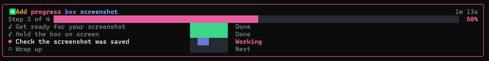

# Clean View

A Claude Code mod that makes Claude Code calm and friendly for people who aren't technical.

While Claude works, tool calls, file diffs and command output are hidden. Instead, a progress box sits above the prompt so you can always see the plan, what's happening now and how far along it is:



The same box, drawn in text:

```
╭──────────────────────────────────────────────────────────────╮
│ ✳ Build my landing page                               1m 12s │
│ Step 2 of 4 ████████████████░░░░░░░░░░░░░░░░░░░░░░░░░░   40% │
│ ✓ Read your brand notes          ██████████  Done            │
│ ● Build the pricing section      ██████░░░░  60%             │
│ ○ Add the contact form           ░░░░░░░░░░  Next            │
│ ○ Polish the footer              ░░░░░░░░░░  Up next         │
╰──────────────────────────────────────────────────────────────╯
```

Claude's written replies stay visible as normal.

## Reading the box

- **Top line:** the job's name in a few plain words, with how long it has been running on the right.
- **Overall bar:** which step Claude is on, a bar for the whole job, and the total percent.
- **Steps:**
  - ✓ a finished step, with a full green meter
  - ● the step happening now, with its meter filling as Claude reports progress. Before the first report, a blue sweep moves across it and it says **Working**.
  - ○ steps still to come, marked **Next** and **Up next**

The frame's colour tells you how things are going:

| Frame | What it means |
|---|---|
| Pink | Claude is working |
| Amber | **Needs you**: Claude is waiting for your OK or has a question (the current step shows ‖), or it's **stuck** and says why in one plain sentence |
| Grey | **Stopped**: you pressed Esc |
| Green | **All done**, with how long it took. After 5 seconds the box shrinks to one line. |

## Install

Type this at the prompt of a Claude Code terminal session:

```
/plugin install clean-view --marketplace mugenracerman/clean-view
```

Answer `y` to add the marketplace, then press Enter to install it for your user.

## Turn it on and off

- Click the **Clean View: On** toggle in the footer under the prompt. It sits beside the other mods' toggles. Or:
- type `/simple on`, `/simple off`, or just `/simple` to flip it.

Your choice is remembered after a restart. When it's off, the box goes away and every hidden row comes back.

## Update

```
claude plugin marketplace update clean-view
claude plugin update clean-view@clean-view
```

Then type `/reload-plugins` in Claude Code, or restart it.

## Good to know

- While it's on, Claude makes a short plain-English plan before every request, even a quick question.
- Each new request makes one small call to Claude Haiku to give the job a short name.
- Permission prompts still appear as normal, so you stay in control of risky actions.

## Tests

```
claude plugin test .
```
